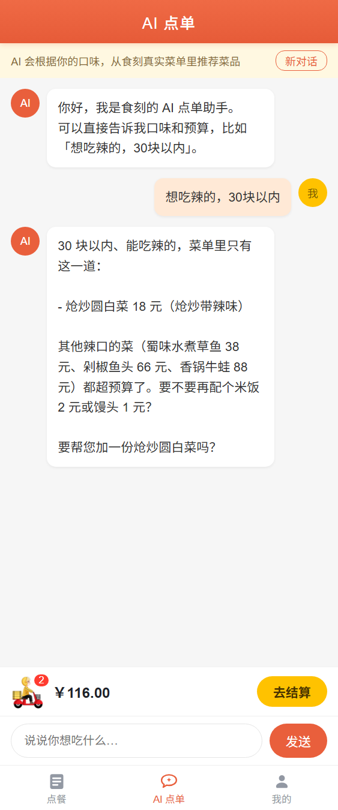
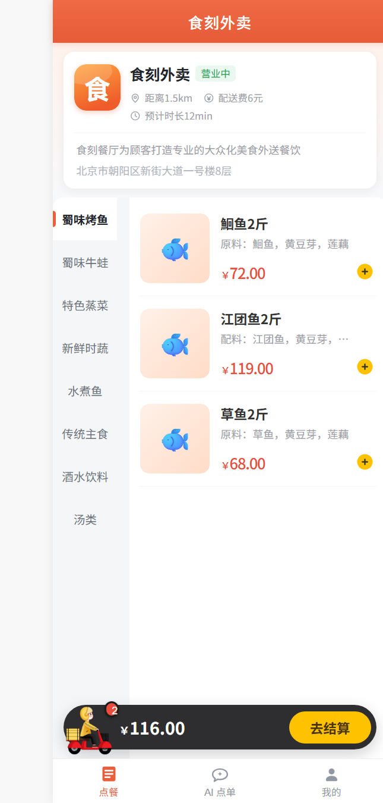
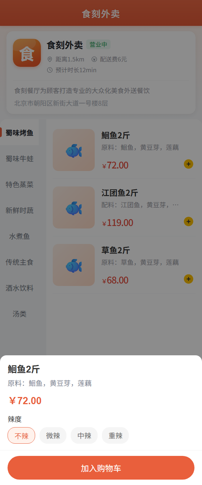
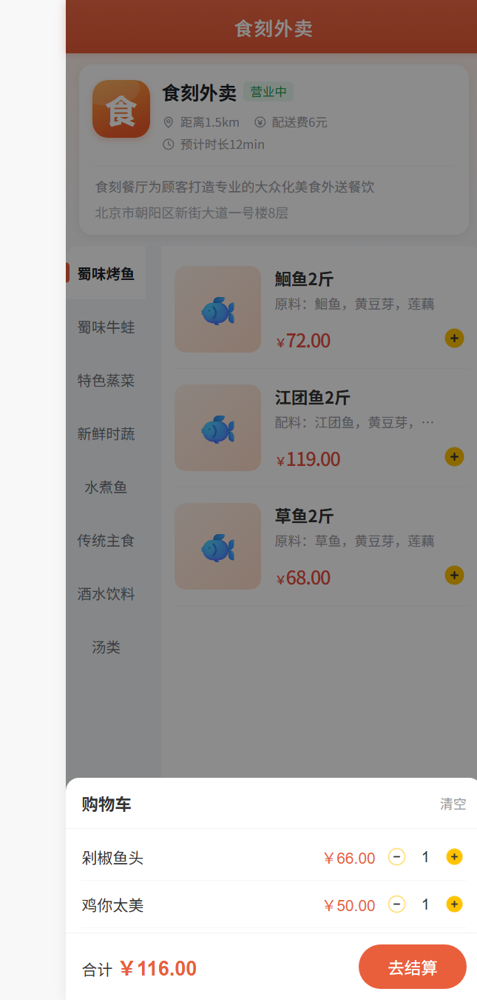
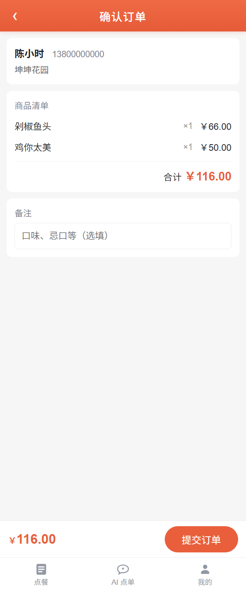
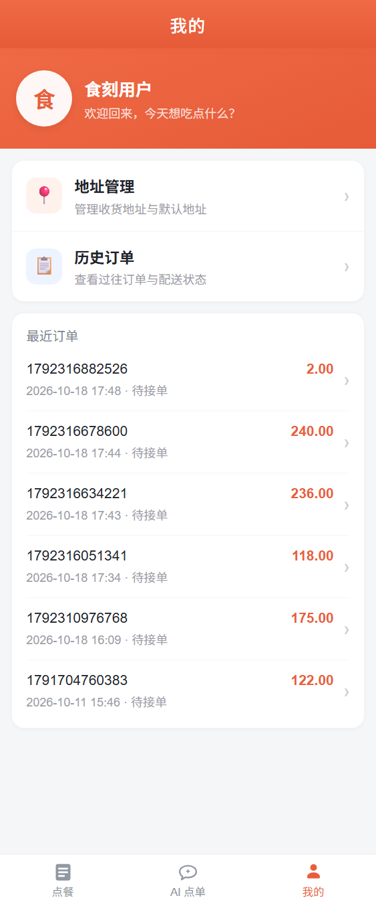
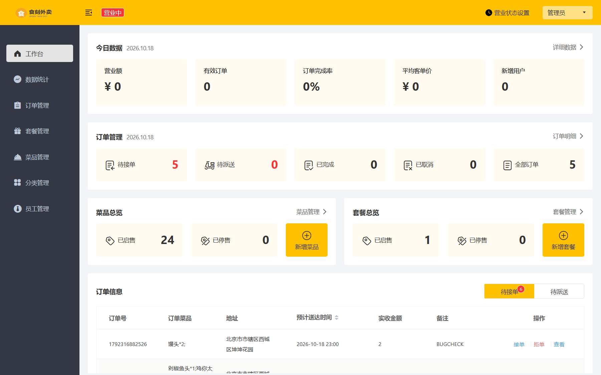
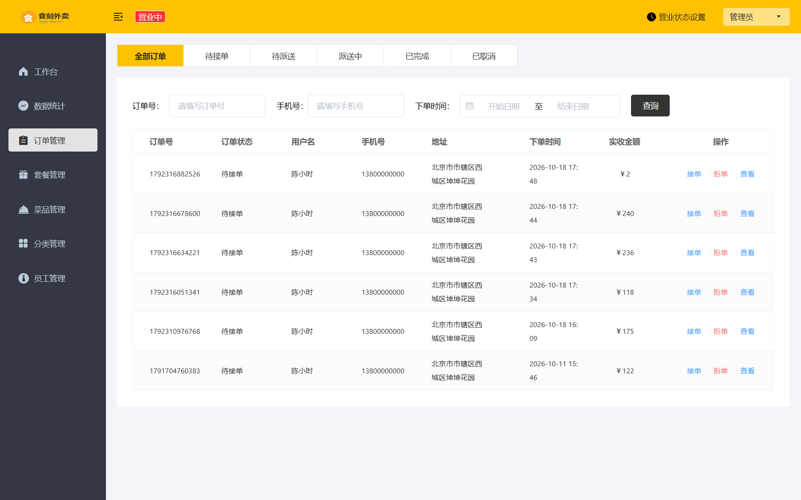

# 食刻外卖（Shike）

基于 Spring Boot 的外卖点餐系统。包含管理端（Web）、用户端（H5）、小程序端三个入口，
并集成一个基于 Tool Calling 的 AI 点单助手：用户用自然语言说需求，AI 查询真实菜单后推荐菜品，
经用户确认后可代加购物车；下单与结算仍由用户完成。


## 功能

**管理端**：工作台数据统计、菜品 / 套餐 / 分类 / 员工管理、订单处理，WebSocket 来单与催单提醒。

**用户端 H5**：店铺浏览、分类点餐、口味规格选择、购物车、收货地址管理、下单与模拟支付、历史订单、AI 点单。

**小程序端**：微信小程序（uni-app 编译产物）。受微信 HTTPS 与域名备案限制，仅支持开发者工具内演示。

**AI 点单**：多轮对话；理解「想吃辣的，30 块以内」这类模糊需求；回答基于真实菜单，不编造菜品；
可代加购物车（先征求用户确认）；支持查询套餐及其组成。

## 技术栈

| 层 | 技术 |
|---|---|
| 后端 | Java 17、Spring Boot 2.7、MyBatis、MySQL 8、Redis、JWT、WebSocket |
| 管理端 | Vue + Element UI（vue-typescript-admin-template） |
| 用户端 | Vue3 全局构建版（无打包步骤，静态托管即可） |
| AI 服务 | Python、FastAPI、LangGraph、DeepSeek API |
| 部署 | nginx（静态托管 + 反向代理） |

## 改造与工程实践

**下单幂等**。下单是 INSERT，天生不幂等。用 Redis `SETNX` 做分布式锁，锁加在 Controller（事务外层）：
事务提交由代理在方法返回之后完成，若锁加在 Service 内部，会出现「锁已释放、事务未提交」的窗口，
第二个请求会读到未清空的购物车，再生成一张订单。已通过并发两请求实测，仅生成一张订单。

**金额服务端重算**。订单金额与明细小计由服务端按购物车（单价 × 数量）计算，请求体里的金额字段一律忽略；
打包费同样不取前端值，避免「传 0.01 元买 188 元菜品」这类篡改。

**接口越权（IDOR）校验**。订单详情 / 取消 / 催单 / 再来一单、地址读写删、下单时的收货地址，
全部校验资源归属当前登录用户。

**AI 工具设计**。菜单数据量小（约 25 条），且菜品名不含口味词（「剁椒鱼头」里没有「辣」字），
关键词检索（LIKE）对模糊需求的命中率为 0。因此只提供 `get_menu` 一个读工具：一次返回全部在售菜品与套餐，
由模型根据名称、描述、分类自行筛选。`add_to_cart` 是写操作，由系统提示词约束「先征求用户确认，绝不擅自执行」。

**AI 链路**。浏览器 → Java（JWT 鉴权）→ Python Agent → 需要数据时回调 Java 内部接口 → MySQL。
Python 不直连数据库：数据出口唯一、数据库密码不外流、SQL 只维护一份。
内部接口用共享密钥校验（`X-Internal-Token`），生产环境 Java 只监听回环地址。

**WebSocket 来单提醒**。会话表使用并发容器；推送失败立即移除失效会话；同一会话的写入加锁，
避免多线程并发写导致的静默丢消息。

**密钥管理**。真实密钥只放在不入库的 `application-local.yml`；仓库历史中曾提交过的密钥已用
git-filter-repo 全量清洗。

## 快速开始

| 依赖 | 版本 |
|---|---|
| JDK | 17 |
| MySQL | 8.x |
| Redis | 近期版本即可 |
| Node.js | ≥ 16（管理端构建） |
| Python | ≥ 3.10（AI 服务） |

### 1. 数据库

```bash
mysql -u root -p < sql/shike_init.sql
```

脚本会创建 `shike` 库并写入基础数据（菜品、分类、套餐、员工、店铺）。

### 2. 后端（端口 8080）

新建 `shike-server/src/main/resources/application-local.yml`（此文件不入库，模板如下）：

```yaml
shike:
  datasource:
    password: 你的MySQL密码
  alioss:
    endpoint: oss-cn-beijing.aliyuncs.com
    access-key-id: 你的AccessKeyId
    access-key-secret: 你的AccessKeySecret
    bucket-name: 你的bucket名
```

IDEA 运行 `ShikeApplication`，或：

```bash
cd shike-server
mvn -pl shike-server -am package -DskipTests
java -jar shike-server/target/shike-server-1.0-SNAPSHOT.jar --spring.profiles.active=dev,local
```

接口文档：<http://localhost:8080/doc.html>

### 3. AI 服务（端口 8000）

```bash
cd shike-ai-agent
python -m venv .venv
.venv/Scripts/pip install -r requirements.txt      # Windows；Linux/macOS 用 .venv/bin/pip
.venv/Scripts/python -m uvicorn app.main:app --host 127.0.0.1 --port 8000
```

需要先设置环境变量 `DEEPSEEK_API_KEY`（从 <https://platform.deepseek.com> 获取）。
可选环境变量：`JAVA_BASE`（Java 地址，默认 `http://127.0.0.1:8080`）、`INTERNAL_TOKEN`（内部接口共享密钥）。

### 4. 管理端

```bash
cd admin-web
npm install --legacy-peer-deps
npm run dev      # 开发模式：http://localhost:8888，/api 代理到 8080
npm run build    # 生产构建，产物在 dist/
```

Node 17+ 与本项目使用的 webpack 4 不兼容，`scripts/vue-cli.js` 已自动注入
`--openssl-legacy-provider`，无需手动设置。

默认账号：`admin / 123456`。

### 5. 用户端 H5

纯静态文件，任意 Web 服务器托管 `shike-user-h5/` 即可。nginx 参考配置：

```nginx
location /app/  { root html; }
location /user/ { proxy_pass http://127.0.0.1:8080; }
location /ws/   {
    proxy_pass http://127.0.0.1:8080;
    proxy_http_version 1.1;
    proxy_set_header Upgrade $http_upgrade;
    proxy_set_header Connection "upgrade";
}
```

### 关于用户端登录

用户端登录走微信 `code` 换 `openid`。本地演示依赖 `shike.wechat.enable-mock: true`
（dev 配置已开启，返回固定测试账号）。上线前必须改为 `false` 并填入真实 appid / secret。

## 目录结构

```
├── sql/                 数据库初始化脚本
├── shike-pojo/          实体 / DTO / VO
├── shike-common/        常量、工具、全局配置属性
├── shike-server/        Web 入口（Controller / Service / Mapper / 拦截器 / 定时任务）
├── admin-web/           管理端源码（Vue + TypeScript）
├── shike-user-h5/       用户端 H5（纯静态，可直接托管）
├── shike-ai-agent/      Python AI 服务（FastAPI + LangGraph）
└── mp-weixin/           小程序端（开发者工具演示）
```

## 演示

以下截图取自本地实际运行的系统，数据为演示数据。

### AI 点单

提问「想吃辣的，30 块以内」，模型先调 `get_menu` 拿到真实菜单，再按预算与口味筛选，
并主动询问是否加购（不会擅自执行写操作）。

<p align="center">
  
</p>

### 用户端 H5

<p align="center">
  
  
  
</p>
<p align="center">
  
  
</p>

从左到右：点餐首页（分类 / 菜品 / 购物车）、菜品详情与口味选择、购物车、确认订单、我的。

### 管理端

<p align="center">
  
  
</p>

左侧：工作台（今日数据、订单概览、待接单提醒）；右侧：订单管理。

> 小程序端为 uni-app 编译产物，受微信 HTTPS 与域名备案限制，仅支持开发者工具内运行，未附图。

## License

仅供学习交流使用。
